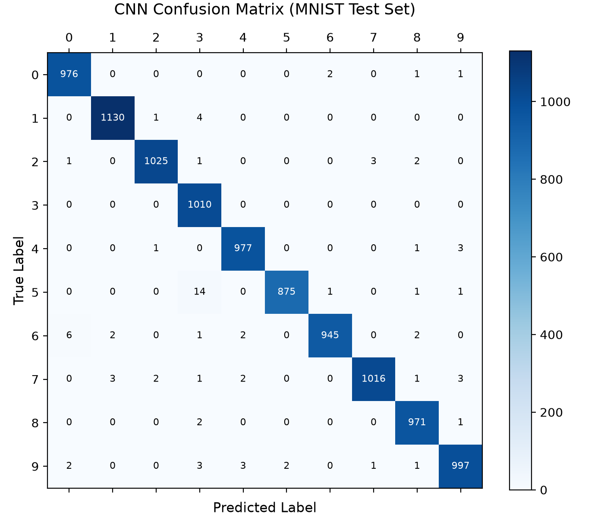
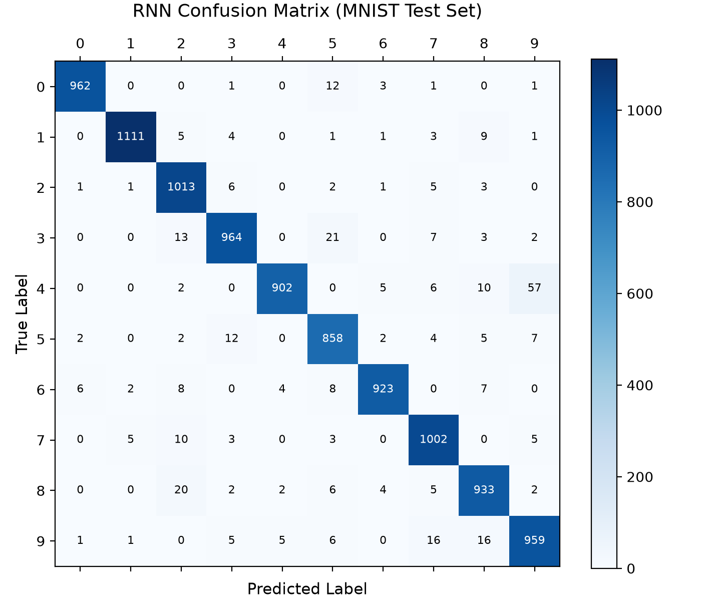
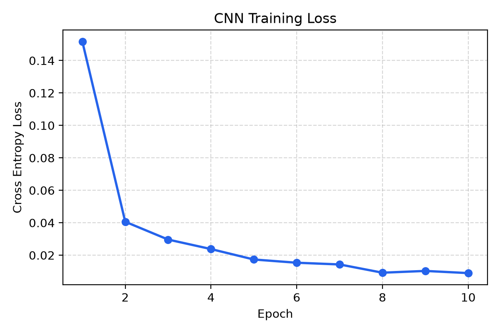
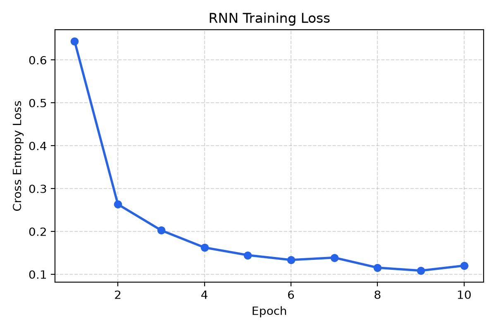

# Digit Duel ⚔️ : CNN vs RNN on MNIST

[](https://github.com/fireside4137/Digit_Duel/actions)
[](https://digitduel-web.vercel.app/)
[](https://www.python.org/)
[](https://pytorch.org/)
[](https://onnxruntime.ai/)
[](https://digitduel-web.vercel.app/)
[](LICENSE)

An end-to-end deep learning project comparing spatial feature extraction (**Convolutional Neural Network**) against sequential row-by-row processing (**Recurrent Neural Network**) on handwritten MNIST digits.

Deployed with **zero cold-starts and zero server costs** using **ONNX Runtime Web**—delivering real-time ($< 5\text{ ms}$) client-side inference directly in the browser via an interactive drawing canvas and image uploader.

---

## 🚀 Live Demo & Web App

- **Live URL**: [https://digitduel-web.vercel.app/](https://digitduel-web.vercel.app/)
- **Key Features**:
  - ✍️ **Interactive Drawing Pad**: Draw any digit $0$ through $9$ with responsive touch and mouse support.
  - 📁 **Image Uploader**: Drag and drop any handwritten digit photo or screenshot.
  - 🔬 **Center-of-Mass Preprocessor**: Replicates Yann LeCun's bounding-box aspect scaling and center-of-mass centering in real time.
  - ⚔️ **Duel Mode**: Pits CNN against RNN simultaneously to compare confidence scores and predictions side-by-side.
  - ⚡ **Zero-Sleep Browser Inference**: Runs locally via WebAssembly using an optimized $1.5\text{ MB}$ ONNX model. Never goes to sleep.

---

## 📊 Benchmark & Architectural Comparison

| Architecture | Paradigm | Parameter Count | Final Test Accuracy | Test Loss | Latency (ONNX Web) |
| :--- | :--- | :--- | :--- | :--- | :--- |
| **CNN** | Spatial 2D Convolutions ($3\times 3$) | $\approx 389\text{K}$ | **99.22%** | $0.0089$ | **$\approx 3.2\text{ ms}$** |
| **RNN** | Sequential Row Scanning ($28$ steps $\times 28$ px) | $\approx 41\text{K}$ | **96.27%** | $0.1202$ | **$\approx 2.1\text{ ms}$** |

### Architectural Breakdown
- **CNN (`src/models/cnn.py`)**:
  - $3\times$ Conv blocks with `ReLU` and `MaxPool2d(2, 2)`:
    - Block 1: `Conv2d(1, 32)` $\rightarrow$ shape `(32, 14, 14)`
    - Block 2: `Conv2d(32, 64)` $\rightarrow$ shape `(64, 7, 7)`
    - Block 3: `Conv2d(64, 128)` $\rightarrow$ shape `(128, 3, 3)`
  - Flatten to 1152 features $\rightarrow$ `Linear(1152, 256)` $\rightarrow$ `Linear(256, 10)` logits.
- **RNN (`src/models/rnn.py`)**:
  - Squeezes channel dimension to treat the image as a sequence of 28 time-steps, with 28 pixels per step.
  - 2-layer `nn.RNN(input_size=28, hidden_size=128, batch_first=True)`.
  - Takes hidden state of the final time step: `Linear(128, 10)` logits.

---

## 📈 Evaluation & Diagnostics

### Confusion Matrices
Both models evaluated across the full 10,000-image MNIST test set:

| CNN Confusion Matrix (99.22% Acc) | RNN Confusion Matrix (96.27% Acc) |
| :---: | :---: |
|  |  |

### Training Loss Curves
| CNN Training Curve | RNN Training Curve |
| :---: | :---: |
|  |  |

---

## 💡 The Engineering Debug Story

### 1. The Accidental Sigmoid Trap in CrossEntropyLoss
During early experiments, the RNN loss refused to drop below $1.53$, stagnating around $84.7\%$ accuracy. The culprit was a subtle line:
```python
# ❌ BUG: Sigmoiding logits before CrossEntropyLoss
output = torch.sigmoid(RNN_model(images))
loss = criterion(output, labels)
```
In PyTorch, `nn.CrossEntropyLoss` combines `nn.LogSoftmax()` and `nn.NLLLoss()`. Passing sigmoid-squashed outputs compressed the gradient space and caused severe vanishing gradients. 

**Fix**: Passing raw logits directly to `criterion(RNN_model(images), labels)` caused the loss to drop from $0.64 \rightarrow 0.12$ and surged test accuracy from **84.7% to 96.3%+** without altering the architecture.

### 2. The Center-of-Mass Preprocessing Problem
A frequent issue with digit recognizers deployed to web canvases is high test accuracy ($99\%$) but terrible real-world performance ($\approx 40\%$). Why?

Because the official MNIST dataset:
1. Strips padding and isolates the digit's bounding box.
2. Scales the bounding box into a $20\times 20$ box preserving aspect ratio.
3. Translates the digit inside a $28\times 28$ field so its **center of mass** sits at $(13.5, 13.5)$.

Both `src/utils/preprocessor.py` (Python) and `web/app.js` (JavaScript) implement this exact transformation, ensuring drawn and uploaded digits match MNIST distribution.

---

## 🗂️ Project Structure

```
Digit_Duel/
├── .github/
│   └── workflows/
│       └── ci.yml               # Automated GitHub Actions test pipeline
├── checkpoints/                 # Saved model weights & ONNX binaries
│   ├── cnn_mnist.pt
│   ├── rnn_mnist.pt
│   ├── cnn_mnist.onnx
│   └── rnn_mnist.onnx
├── data/                        # MNIST dataset (cached locally, ignored by git)
├── reports/                     # Confusion matrices & loss curves
│   ├── confusion_matrix_cnn.png
│   ├── confusion_matrix_rnn.png
│   ├── learning_curves_cnn.png
│   └── learning_curves_rnn.png
├── src/                         # Modular Python package
│   ├── config.py                # Hyperparameters, directory paths
│   ├── dataset.py               # DataLoaders & torchvision transforms
│   ├── models/                  # CNN & RNN architectures
│   │   ├── cnn.py
│   │   └── rnn.py
│   ├── utils/                   # Device detection, preprocessor, metrics
│   │   ├── device.py
│   │   ├── metrics.py
│   │   └── preprocessor.py
│   ├── train.py                 # CLI training script
│   ├── evaluate.py              # Test set evaluation & confusion matrix generation
│   ├── export_onnx.py           # PyTorch to standalone ONNX converter
│   └── predict.py               # Single image CLI inference
├── tests/                       # Unit tests
│   └── test_models.py
├── web/                         # Browser application for Vercel / GitHub Pages
│   ├── index.html
│   ├── styles.css
│   ├── app.js                   # ONNX Runtime Web client engine
│   └── models/                  # Embedded ONNX binaries
├── .gitignore
├── LICENSE
├── pyproject.toml
├── requirements.txt
└── vercel.json                  # Zero-configuration Vercel deployment
```

---

## 🛠️ Quickstart Guide

### 1. Installation
Clone the repository and install dependencies:
```bash
git clone https://github.com/fireside4137/Digit_Duel.git
cd Digit_Duel
pip install -r requirements.txt
```

### 2. Train Models
Train either architecture with automatic Apple Silicon MPS / CUDA detection:
```bash
# Train CNN (10 epochs)
python src/train.py --model cnn --epochs 10

# Train RNN (10 epochs)
python src/train.py --model rnn --epochs 10
```

### 3. Evaluate & Generate Confusion Matrices
```bash
python src/evaluate.py --model cnn
python src/evaluate.py --model rnn
```

### 4. Single-Image CLI Prediction
Test prediction on any image:
```bash
python src/predict.py --image reports/sample_test_7.png --model cnn
```

### 5. Run Web Demo Locally
Serve the static web folder using Python's built-in HTTP server:
```bash
python -m http.server 3000 --directory web
```
Open [http://localhost:3000](http://localhost:3000) in your browser.

---

## 🌐 Deploy to Vercel (Zero Sleep, 100% Free)

1. Fork or push this repository to your GitHub account: `https://github.com/fireside4137/Digit_Duel`.
2. Go to [Vercel](https://vercel.com/) and click **"Add New Project"**.
3. Import `Digit_Duel`.
4. Click **Deploy** (the included `vercel.json` automatically routes traffic to `web/index.html`).
5. Your live app is now online at [https://digitduel-web.vercel.app/](https://digitduel-web.vercel.app/) with 100% uptime and zero cold-starts!

---

## 📜 License
This project is licensed under the [MIT License](LICENSE).
